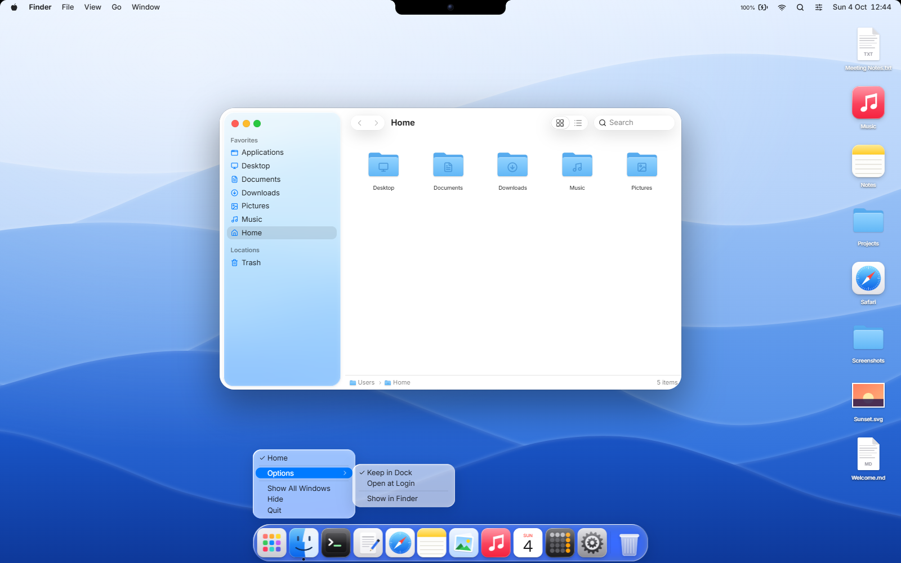
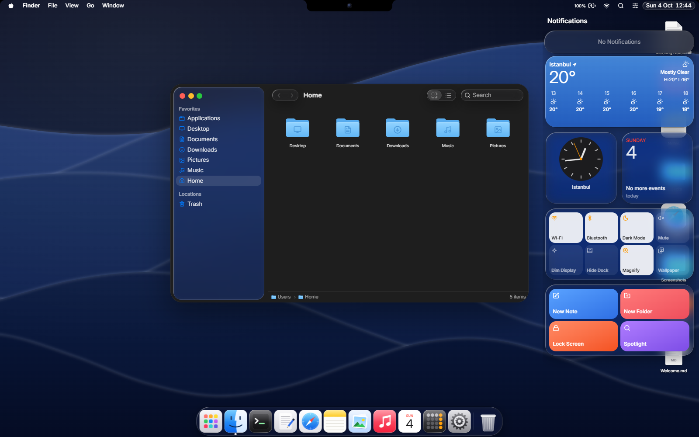

# macOS Web



[Türkçe](#türkçe) · [English](#english)

## Türkçe

macOS Tahoe'nun Liquid Glass görünümünü tarayıcıya taşıyan bir masaüstü. Pencereleri sürükleyip
boyutlandırabilir, Dock'tan uygulama açabilir, Finder'da dosya taşıyabilir, Terminal'de komut çalıştırabilirsin.
Dosyalar, notlar ve ayarlar tarayıcıda saklanır, sayfayı yenileyince kaybolmaz.

İçinde Finder, Terminal, TextEdit, Safari, Notes, Preview, Music, Calendar, Calculator ve System Settings var.
Spotlight, Launchpad, Control Center, Mission Control, bildirimler ve ⌘Tab da çalışıyor. Menü çubuğundaki saate
tıklayınca açılan Bildirim Merkezi'nde hava durumu, saat, takvim, kontrol ve kısayol widget'ları var. Dock'ta bir
ikona sağ tıklayınca macOS'taki menü açılıyor: pencere listesi, Options (Keep in Dock, Open at Login), Show All
Windows, Hide ve Quit.

Apple'a ait hiçbir dosya kullanılmadı. İkonlar, duvar kâğıtları (dalgalar ve dağ manzarası dahil) ve logo bu proje
için kodla çizildi. Logo Apple'ı andırıyor ama ısırığı olmayan sade bir meyve silueti.

### Çalıştırma

[Bun](https://bun.sh) gerekli.

```bash
bun install
bun dev          # geliştirme sunucusu
bun run build    # dist/ klasörüne production çıktısı
bun test
docker compose up -d --build  # → localhost:8080
```

Giriş ekranında herhangi bir şifre olur, Enter'a basman yeterli.

### Yeni uygulama eklemek

`src/apps/` altına bir bileşen yaz, `src/os/apps.ts` içindeki `APPS` listesine bir kayıt ekle. Dock, Launchpad,
Spotlight ve menü çubuğu uygulamayı kendiliğinden görür. İkonu `src/ui/AppIcons.tsx` içine bir SVG bileşeni olarak
ekleyebilirsin.

### Bilmen gerekenler

- Çoğu site iframe içinde açılmayı reddettiği için Safari'de her sayfa açılmaz. Her sayfada "yeni sekmede aç"
  bağlantısı var.
- Windows ve Linux'ta ⌘ yerine Ctrl kullanılıyor. Ctrl+W gibi tarayıcının kendine ayırdığı kısayollar sayfaya
  ulaşmıyor; bu komutlar menüden çalışıyor.
- Camdaki kırılma efekti yalnızca Chromium tabanlı tarayıcılarda (Chrome, Edge, Arc) görünüyor. Diğer
  tarayıcılarda cam düz bulanıklıkla çiziliyor.
- Hava durumu widget'ı verisini [Open-Meteo](https://open-meteo.com)'dan alıyor. Konum izni istemiyor; şehri saat
  diliminden tahmin ediyor (ör. `Europe/Istanbul` → Istanbul) ve yalnızca o şehrin adını gönderiyor. İnternet yoksa
  widget görünmüyor.
- Masaüstü için tasarlandı, telefonda kullanışlı değil.

## English

A desktop in the browser that recreates macOS Tahoe and its Liquid Glass look. You can drag and resize windows,
launch apps from the Dock, move files around in Finder and run commands in Terminal. Files, notes and settings are
saved in the browser, so a reload doesn't wipe them.

It ships with Finder, Terminal, TextEdit, Safari, Notes, Preview, Music, Calendar, Calculator and System Settings,
plus Spotlight, Launchpad, Control Center, Mission Control, notifications and ⌘Tab. Click the clock in the menu bar
to open Notification Center, where the weather, clock, calendar, controls and shortcut widgets live. Right-click a
Dock icon for the macOS Dock menu: its windows, Options (Keep in Dock, Open at Login), Show All Windows, Hide and
Quit.

No Apple assets are used. The icons, the wallpapers (waves and mountains included) and the logo are drawn in code
for this project. The logo nods to Apple's but is a plain fruit silhouette with no bite.

### Running it

You need [Bun](https://bun.sh).

```bash
bun install
bun dev          # dev server
bun run build    # production build in dist/
bun test
docker compose up -d --build  # → localhost:8080
```

Any password works on the login screen, just press Enter.

### Adding an app

Write a component in `src/apps/` and add one entry to the `APPS` list in `src/os/apps.ts`. The Dock, Launchpad,
Spotlight and the menu bar pick it up on their own. Its icon goes in `src/ui/AppIcons.tsx` as an SVG component.

### Good to know

- Safari can't show every site, because most of them refuse to load inside an iframe. Each page has an "open in
  new tab" link.
- On Windows and Linux, Ctrl stands in for ⌘. Shortcuts the browser reserves for itself, like Ctrl+W, never reach
  the page; those commands still work from the menus.
- The glass refraction effect only shows up in Chromium browsers (Chrome, Edge, Arc). Elsewhere the glass falls
  back to a plain blur.
- The weather widget gets its data from [Open-Meteo](https://open-meteo.com). It never asks for your location; it
  guesses the city from your time zone (e.g. `Europe/Istanbul` → Istanbul) and sends only that city's name. When
  you're offline, the widget simply doesn't show.
- It's built for desktop screens, not phones.


